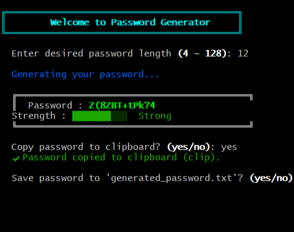

# Linux Password Generator

A Bash password generator that creates random passwords of a chosen
length (4–128), shows a strength indicator, and can copy the password to
the clipboard or save it to a file.

## Features

* Random characters from `/dev/urandom`
* Guarantees at least one uppercase, lowercase, digit, and special
  character in every password
* Strength indicator based on length
* Clipboard copy (`xclip` / `xsel` on Linux, `clip` on Windows)
* Save or append to `generated_password.txt`
* Loop to generate several passwords per run

## Requirements

* Bash
* Linux or Git Bash on Windows

Optional — for clipboard support:

```bash
sudo apt install xclip        # Ubuntu / Debian
sudo dnf install xclip        # Fedora
sudo pacman -S xclip          # Arch
```

## Usage

```bash
chmod +x password_generator.sh
./password_generator.sh
```

Example session (trimmed):

```text
╔══════════════════════════════════════════╗
║        Welcome to Password Generator     ║
╚══════════════════════════════════════════╝

  Enter desired password length (4 - 128): 14

  Password : K7#mQ2@xL9!pW
  Strength : ███████░░░  Strong
```

## Notes

* Password length is validated as an integer between 4 and 128.
* Each password contains at least one uppercase, lowercase, digit, and
  special character, then the characters are shuffled so the guaranteed
  ones are not grouped at the start.
* The hyphen in the special-character set must be last — otherwise `tr`
  treats `()-_` as a character range.
* Optional saved passwords remain plaintext. The script restricts file permissions and rejects obvious unsafe output paths on Linux; this is not encrypted storage or protection against concurrent local path changes. Use a password manager for real credentials. The output file is ignored by Git when run in the project directory.

## License

MIT — see [LICENSE](../../LICENSE).
